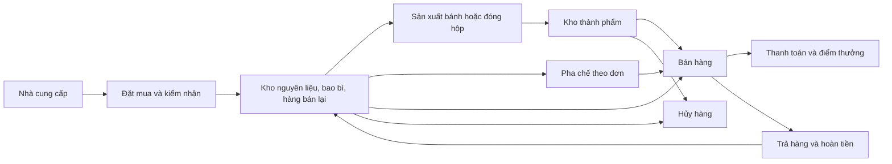

# Nghiệp vụ tiệm bánh Maison Douce

**Ngày biên soạn:** 15/10/2026.  
**Mục đích:** cung cấp ngữ cảnh kinh doanh đầy đủ để người mới hoặc một cuộc trò chuyện mới có thể hiểu cửa hàng, các nghiệp vụ và ý nghĩa số liệu mà không cần đọc lại lịch sử trao đổi.

Tài liệu được tổng hợp từ các yêu cầu kinh doanh trong quá trình xây dựng tiệm, danh mục và dữ liệu chuẩn bị khai trương, công thức sản phẩm, quy tắc vận hành và từ điển nghiệp vụ hiện có. Những giá trị được ghi là **tham chiếu** hoặc **giả định** có thể thay đổi theo chính sách kinh doanh; chúng không phải bằng chứng về thị trường hay cam kết của nhà cung cấp.

## 1. Bức tranh tổng quan

Maison Douce là tiệm bánh ngọt Pháp quy mô nhỏ tại TP. Hồ Chí Minh, có bếp bánh, quầy pha chế, khách dùng tại tiệm, mua mang đi và giao hàng. Cửa hàng bán:

- Bánh cán lớp, macaron, mousse và entremet.
- Cà phê, trà, nước pha chế và chocolate nóng.
- Hộp bánh, set mang về, chocolate đóng gói, cà phê hạt và mứt.
- Vật phẩm mang thương hiệu tiệm, hiện có ly tái sử dụng.

Chuỗi nghiệp vụ chính:



### Các nguyên tắc cần nhớ ngay

1. Hóa đơn, dòng hàng, thanh toán, hoàn trả và biến động tồn kho là các đối tượng có mức chi tiết khác nhau.
2. Một sản phẩm bán cho khách và một mặt hàng quản lý trong kho không phải cùng một khái niệm.
3. Giá và tên lúc bán phải được giữ lại; đổi menu không làm thay đổi lịch sử giao dịch.
4. Tồn kho được tính từ các lần tăng/giảm thực tế. Có hồ sơ lô hàng không đồng nghĩa còn hàng.
5. Có khách không đăng ký thông tin và có khách không mua nước; cả hai đều là tình huống hợp lệ.
6. Hóa đơn hoàn một phần vẫn có thể chứa nhiều sản phẩm đã bán và không bị trả.
7. Tiền, điểm thưởng, số chiếc, số hộp, gram và millilitre phải được phân biệt rõ.
8. Ngày bắt đầu kinh doanh thuộc về chi nhánh; không suy ra từ ngày có hóa đơn đầu tiên.
9. Kế hoạch sản xuất không phải sản lượng thực tế; số phiếu hủy không phải lượng hủy.
10. Các phép đối soát là quy tắc nghiệp vụ cần kiểm tra, không phải điều luôn được bảo đảm chỉ vì chứng từ tồn tại.

## 2. Chi nhánh, thời gian và phạm vi hoạt động

### 2.1. Chi nhánh

- Chi nhánh tham chiếu hiện tại: **Maison Douce - Cửa hàng chính**, mã `MAIN`, tại TP. Hồ Chí Minh.
- Một chi nhánh có tên, mã nhận diện, địa chỉ/liên hệ nếu đã khai báo, múi giờ, ngày mở bán và trạng thái hoạt động.
- Ngày mở bán đã được đối chiếu trong phiên làm việc ngày 14/10/2026 là **10/09/2026**. Đây là thông tin của chi nhánh đang xét, không phải ngày mặc định áp dụng cho mọi chi nhánh hoặc mọi lần chuẩn bị cửa hàng.
- Nếu hồ sơ chi nhánh được cập nhật, sử dụng ngày mở bán và múi giờ trong hồ sơ có hiệu lực thay vì mặc định giữ ngày nêu trên.
- Trạng thái đang hoạt động không cho biết chi nhánh mở cửa mọi ngày, cũng không thay thế lịch đóng cửa/nghỉ lễ.

### 2.2. Ngày kinh doanh

- Múi giờ tham chiếu: `Asia/Ho_Chi_Minh`.
- Khung giờ bán hàng hiện tại: **07:00 đến trước 22:00** theo giờ địa phương.
- Bếp, nhận hàng và chuẩn bị quầy có thể diễn ra trước giờ bán; chuẩn bị khai trương có thể diễn ra trước ngày mở bán.
- Thời điểm mở hóa đơn phản ánh bắt đầu tiếp nhận đơn. Thời điểm hoàn tất hóa đơn phản ánh hoàn tất bán hàng. Không dùng hai mốc này thay thế nhau một cách ngầm định.
- Các ngày sản xuất, nhận lô và hết hạn có thể chỉ là ngày lịch, không có giờ/phút.
- Mỗi nghiệp vụ phải có thời điểm phù hợp với chính nó; nhiều bản ghi không mặc nhiên có cùng thời gian.
- Báo cáo tại một mốc chỉ bao gồm hoạt động đã phát sinh đến mốc đó. Không tính phần còn lại của ngày hoặc các ngày tương lai là hoạt động đã xảy ra.

### 2.3. Tình trạng chuẩn bị mở bán

Trước khách đầu tiên, cửa hàng đã có nhân sự, menu, đơn vị tính, nhà cung cấp, nguyên liệu/bao bì/hàng bán lại, công thức, giá tham chiếu và chương trình khai trương. Có thể đã có đơn mua, phiếu nhận hàng, lô tồn, biến động nhập kho, mẻ bánh và tiêu hao phục vụ khai trương.

Ở trạng thái này **chưa có khách đăng ký từ giao dịch, hóa đơn bán, dòng bán, thanh toán, lượt sử dụng khuyến mãi, điểm thưởng, trả hàng hay hoàn tiền**. Có tồn kho và mẻ bánh trước giờ bán là bình thường; không được coi chúng là doanh số.

Lịch chuẩn bị tham chiếu: đặt mua từ ngày trước khai trương, nhận hàng lúc 05:00 ngày mở bán, sản xuất đầu ngày 05:30–06:30, sẵn sàng bán lúc 07:00. Đây là lịch chuẩn bị, không phải khung giờ bắt buộc cho mọi ngày về sau.

## 3. Những đối tượng nghiệp vụ và mức chi tiết

| Đối tượng | Một bản ghi đại diện cho | Quan hệ chính |
|---|---|---|
| Chi nhánh — Branch | Một địa điểm kinh doanh | Có nhân viên, hóa đơn, kho và ca làm |
| Nhóm sản phẩm — Product category | Một nhóm menu; có thể có nhóm cha | Chứa nhiều sản phẩm |
| Đơn vị tính — Unit of measure | Một đơn vị khối lượng, thể tích, đếm hoặc chiều dài | Dùng cho mua, kho, công thức và bán |
| Nhà cung cấp — Supplier | Một đối tác cung ứng | Cung ứng nhiều mặt hàng |
| Khách hàng — Customer | Một hồ sơ khách/thành viên | Có thể có nhiều hóa đơn và biến động điểm |
| Nhân viên — Employee | Một hồ sơ nhân sự | Tham gia nhận hàng, sản xuất, bán, hủy và ca làm |
| Chất gây dị ứng — Allergen | Một khái niệm chất/nhóm chất | Có thể liên quan nhiều sản phẩm |
| Mặt hàng kho — Stock item | Một nguyên liệu, bao bì, thành phẩm hoặc hàng bán lại | Có đơn vị cơ sở, lô và biến động kho |
| Sản phẩm — Product | Một mã hàng trên menu hoặc quầy bán | Có nhóm, đơn vị bán, giá và có thể liên kết mặt hàng kho |
| Hàng do nhà cung cấp chào bán — Supplier item | Một cặp nhà cung cấp–mặt hàng | Lưu mã hàng, quy cách và giá tham chiếu |
| Khai báo dị ứng sản phẩm — Product allergen | Một cặp sản phẩm–chất dị ứng | Có trạng thái xác nhận và ghi chú |
| Công thức — Recipe | Một phiên bản công thức của một sản phẩm | Có định lượng đầu ra, thời gian hiệu lực và thành phần |
| Thành phần công thức — Recipe component | Một thành phần trong một công thức | Có lượng cần dùng, đơn vị, cờ tùy chọn |
| Đơn mua — Purchase order | Một đơn đặt với một nhà cung cấp | Có nhiều dòng mua và có thể nhiều lần nhận |
| Dòng mua — Purchase order line | Một mặt hàng trong một đơn mua | Lưu lượng đặt và đơn giá dự kiến |
| Phiếu nhận hàng — Goods receipt | Một lần nhận từ nhà cung cấp | Có nhiều dòng/lô; có thể liên kết đơn mua |
| Lô hàng — Inventory lot | Một lô của một mặt hàng | Có nguồn, ngày nhận/sản xuất/hết hạn và giá vốn nếu biết |
| Dòng nhận hàng — Receipt line | Một lượng hàng hoặc phân bổ lô trong lần nhận | Có lượng thực nhận và giá thực nhận |
| Biến động kho — Stock movement | Một lần tăng/giảm lượng kho | Gắn chi nhánh, mặt hàng, lô và nghiệp vụ nguồn |
| Mẻ sản xuất — Production batch | Một lần sản xuất/đóng gói một sản phẩm | Gắn công thức, kế hoạch, thực tế và người thực hiện |
| Tiêu hao mẻ — Production consumption | Một phân bổ đầu vào cho mẻ theo mặt hàng/lô | Có lượng dùng và giá vốn lịch sử |
| Khuyến mãi — Promotion | Một ưu đãi và điều kiện áp dụng | Có danh sách sản phẩm hợp lệ và các lần sử dụng |
| Sản phẩm được ưu đãi — Promotion eligibility | Một cặp ưu đãi–sản phẩm | Chỉ xác định phạm vi áp dụng |
| Hóa đơn bán — Sale/receipt | Một giao dịch bán | Có nhiều dòng hàng, thanh toán, ưu đãi và có thể hoàn trả |
| Dòng bán — Sale line | Một dòng sản phẩm trên hóa đơn | Giữ tên, giá, đơn vị, lượng và giảm giá lúc bán |
| Ưu đãi đã áp dụng — Applied promotion | Một cặp hóa đơn–ưu đãi đã sử dụng | Có số tiền giảm thực tế và thời điểm áp dụng |
| Thanh toán — Payment | Một khoản/lần xử lý thanh toán | Nhiều bản ghi có thể thuộc một hóa đơn |
| Biến động điểm — Loyalty transaction | Một lần cộng/trừ điểm của khách | Có thể liên quan hóa đơn hoặc điều chỉnh riêng |
| Phiếu trả — Return | Một trường hợp trả/hoàn tiền của một hóa đơn gốc | Có nhiều dòng trả |
| Dòng trả — Return line | Một lượng trả của một dòng bán gốc | Có lượng trả, tiền hoàn và khả năng nhập lại |
| Phiếu hủy — Waste record | Một lần loại bỏ mặt hàng/lô | Có lượng, lý do và người ghi nhận |
| Ca làm/quầy tiền — Shift | Một khoảng làm việc/quản lý quỹ tại chi nhánh | Có quỹ đầu ca và các khoản thu/chi |
| Biến động tiền mặt — Cash movement | Một lần tiền vào/ra quỹ ca | Có loại, số tiền dương và thời điểm |

Tên hiển thị không nhất thiết duy nhất. Mã định danh của sản phẩm, khách, mặt hàng và chứng từ mới xác định đối tượng. Mã lô chỉ duy nhất trong phạm vi một mặt hàng; không ghép các lô khác mặt hàng chỉ vì trùng tên lô.

## 4. Menu, phân loại sản phẩm và đơn vị

### 4.1. Ba cách phân loại khác nhau

**Loại sản phẩm bán:**

| Giá trị | Ý nghĩa |
|---|---|
| `BAKERY` | Bánh bán theo chiếc/phần |
| `BEVERAGE` | Đồ uống pha chế |
| `RETAIL` | Hàng bán lẻ, bao gồm hộp bánh/set mang về |
| `MERCH` | Vật phẩm của tiệm |

**Nhóm menu:** Bánh cán lớp; Macaron; Bánh mousse và entremet; Cà phê; Trà và nước pha chế; Chocolate và đồ uống sữa; Hộp bánh và set mang về; Hàng đóng gói bán lẻ; Vật phẩm của tiệm.

**Loại mặt hàng kho:** `RAW_MATERIAL` là nguyên liệu; `PACKAGING` là bao bì; `FINISHED_GOOD` là thành phẩm; `RETAIL_GOOD` là hàng bán lại/đóng gói/vật phẩm quản lý trong kho.

Ví dụ: một hộp macaron thuộc nhóm menu “Hộp bánh và set mang về”, loại sản phẩm `RETAIL`, trong khi các chiếc macaron dùng để đóng hộp là những mặt hàng thành phẩm riêng. Ly tái sử dụng là `MERCH`, không phải doanh số đồ uống.

### 4.2. Đơn vị và giá

- Đơn vị khối lượng: gram (`G`), kilogram (`KG`); thể tích: millilitre (`ML`), litre (`L`).
- Đơn vị đếm: chiếc (`EA`), hộp (`BOX`), gói/set (`PACK`), chai (`BOTTLE`). Chiều dài là một nhóm đơn vị có thể mở rộng nhưng chưa có đơn vị tham chiếu ban đầu.
- Giá bán là **VND trên một đơn vị bán**. Giá vốn là tiền trên đơn vị lượng tương ứng; nhiều nguyên liệu dùng VND/gram hoặc VND/millilitre.
- 1.000 gram = 1 kilogram và 1.000 millilitre = 1 litre là các quy đổi khối lượng/thể tích. Không áp dụng các tỷ lệ này cho hộp/gói/chai.
- 1 hộp, 1 gói và 1 chiếc không phải cùng một lượng vật lý. Chỉ quy đổi số bánh trong hộp khi quy cách hoặc công thức đóng hộp đã được xác nhận.
- Không tự đổi số trứng sang gram, millilitre sang gram hoặc số gói cà phê sang lượng đồ uống.
- Chi tiết giỏ hàng lưu giá, tên và đơn vị tại thời điểm giao dịch. Không tính lại doanh số cũ bằng giá menu hiện tại.
- Giá chưa biết khác giá bằng 0. Hiện tại mặt hàng đủ điều kiện đưa vào bán phải đang hoạt động, có giá dương và nằm trong thời gian được phép bán; hai đầu ngày hiệu lực đều được tính.
- Tiền làm tròn 2 chữ số thập phân theo nguyên tắc nửa lên; lượng vận hành thường ghi 3 chữ số thập phân, định lượng công thức/tiêu hao có thể có 4.

Menu và mức giá tham chiếu đầy đủ nằm ở Phụ lục A.

## 5. Nguồn cung, mua hàng và kiểm nhận

### 5.1. Nhà cung cấp và quy cách

Một nhà cung cấp có thể là nhà sản xuất (`MANUFACTURER`), phân phối (`DISTRIBUTOR`), bán lẻ (`RETAILER`), nhà rang cà phê (`ROASTER`), nguồn chợ địa phương (`LOCAL_MARKET`) hoặc nguồn khác (`OTHER`). Một mặt hàng có thể có nhiều nguồn cung.

Các tên đã đưa vào danh mục tham chiếu gồm Phát An An cho bột Baker’s Choice; GoodFood Vietnam cho Président; Beemart cho Anchor; Puratos Grand-Place Vietnam cho chocolate/cacao; Taka Foods cho syrup MONIN; và nguồn thực phẩm địa phương cho các mặt hàng còn lại. **Đây là danh mục tham khảo của mô hình kinh doanh, không xác nhận hợp đồng, tồn hàng, báo giá hiện tại hoặc xuất xứ từng lô.**

Mỗi cặp nhà cung cấp–mặt hàng có thể có mã hàng bên bán, thương hiệu, đơn vị mua, quy cách đóng gói, đơn giá biết gần nhất và loại tiền. Giá biết gần nhất không thay thế đơn giá đã chốt của từng đơn mua/phiếu nhận, cũng chưa tạo thành lịch sử báo giá đầy đủ.

### 5.2. Vòng đời đơn mua

| Trạng thái | Ý nghĩa |
|---|---|
| `DRAFT` | Đang chuẩn bị, chưa gửi |
| `SENT` | Đã gửi nhà cung cấp, đang chờ nhận |
| `PARTIALLY_RECEIVED` | Đã nhận một phần |
| `RECEIVED` | Được ghi nhận đã nhận đủ |
| `CANCELLED` | Đã hủy |

Luồng nghiệp vụ thông thường: chuẩn bị → gửi → nhận một phần hoặc nhận đủ; có thể hủy theo xử lý thực tế. Danh sách trạng thái không tự chứng minh các bước đã diễn ra đúng thứ tự.

- Một đơn mua có nhiều dòng. Lượng đặt, đơn vị và giá dự kiến thuộc dòng mua.
- Giá trị dự kiến của dòng = lượng đặt × giá dự kiến, nếu đã biết giá.
- Lập đơn mua **chưa làm tăng tồn kho**.
- Một đơn có thể có nhiều lần nhận; một dòng mua có thể được nhận qua nhiều dòng/lô.
- Phiếu nhận giữ lượng thực nhận và đơn giá thực nhận. Khi kiểm tra thiếu/thừa phải cộng các dòng nhận trong cùng đơn vị, không nhân lượng đặt qua từng phiếu.
- Có thể nhận hàng không liên kết đơn mua đã ghi trước. Số hóa đơn nhà cung cấp và số phiếu nhận nội bộ phục vụ mục đích khác nhau.
- Chỉ hàng đã nhận và ghi tăng kho mới tham gia số lượng tồn. Giá thực nhận cập nhật giá tham chiếu của cặp nhà cung cấp–mặt hàng khi có đủ thông tin.

### 5.3. Chính sách bổ sung hàng hiện tại

Chính sách tự động hiện tại áp dụng cho nguyên liệu, bao bì và hàng bán lại có ngưỡng đặt lại đã khai báo:

```text
Nếu tồn khả dụng <= ngưỡng đặt lại:
    Lượng đề nghị mua = max(2 × ngưỡng - tồn khả dụng, ngưỡng)
```

- Không tạo thêm đề nghị trùng mặt hàng/chi nhánh nếu đã có đơn `SENT` hoặc `PARTIALLY_RECEIVED` đang chờ.
- Gộp các dòng cùng nhà cung cấp thành một đơn mua.
- Nguồn hiện tại được chọn trong các nhà cung cấp và liên kết mặt hàng đang hoạt động, ưu tiên nguồn có giá tham chiếu; **chưa phải thuật toán chọn giá thấp nhất, chất lượng tốt nhất hay thời gian giao tối ưu**.
- Nếu chưa biết giá tham chiếu, có thể tham khảo giá lô nhận gần nhất đã biết. Nếu vẫn chưa biết, phải giữ tình trạng chưa biết giá.
- Hiện có giả định thời gian chờ nhận tối thiểu khoảng 24 giờ tại mốc đánh giá; xử lý tự động chủ yếu nhận đủ theo lượng đặt. Nhận nhiều đợt, giao trễ và nhận vượt đơn là những tình huống cần đối soát riêng.
- Không có ngưỡng hoặc không có nguồn cung phù hợp có thể khiến không phát sinh đặt lại; điều này không chứng minh mặt hàng không cần mua.

## 6. Kho, lô hàng và hạn dùng

### 6.1. Cách tính tồn

```text
Tồn tại thời điểm t của chi nhánh/mặt hàng/lô
    = Tổng lượng tăng/giảm phát sinh đến t, sau khi thống nhất đơn vị.
```

- Lô giữ thông tin mặt hàng, nguồn nhận, mã lô, ngày sản xuất, ngày nhận, ngày hết hạn và giá vốn nếu biết.
- Lượng tồn theo chi nhánh nằm ở các biến động của chi nhánh; không nằm trong tên lô hoặc chỉ trong hồ sơ mặt hàng.
- Tồn sổ sách và tồn khả dụng có thể khác nhau do lô hết hạn hoặc hàng không đủ điều kiện bán.
- Khi phân tích tồn tại một ngày quá khứ phải giới hạn đến ngày đó; không cộng các lần nhập/xuất xảy ra sau thời điểm phân tích.

Đối soát một kỳ theo cùng chi nhánh, mặt hàng, lô và đơn vị:

```text
Tồn cuối kỳ = Tồn đầu kỳ + Nhập mua + Đầu ra sản xuất + Nhập lại hàng trả
             - Xuất bán - Tiêu hao sản xuất - Hủy
             + Điều chuyển ròng + Điều chỉnh ròng.
```

Tồn đầu kỳ phải dựa trên số dư đã hình thành trước kỳ. Không cộng thêm “tồn đầu” nếu các lần nhập tạo tồn đầu đã được cộng trong toàn bộ lịch sử biến động.

### 6.2. Loại biến động và dấu

| Loại | Ý nghĩa | Dấu lượng thông thường |
|---|---|---:|
| `PURCHASE_RECEIPT` | Nhập từ nhà cung cấp | + |
| `PRODUCTION_CONSUMPTION` | Đầu vào dùng cho sản xuất/đóng hộp | − |
| `PRODUCTION_OUTPUT` | Nhập thành phẩm sau sản xuất | + |
| `SALE` | Xuất hàng/nguyên liệu phục vụ bán | − |
| `RETURN_IN` | Nhập lại hàng trả đủ điều kiện | + |
| `WASTE` | Loại bỏ hàng | − |
| `ADJUSTMENT_IN` / `ADJUSTMENT_OUT` | Điều chỉnh tăng / giảm | + / − |
| `TRANSFER_IN` / `TRANSFER_OUT` | Nhận / chuyển giữa địa điểm | + / − |

Lượng biến động có dấu thực tế; loại biến động giải thích nguyên nhân. Khi đối soát phải kiểm tra dấu, đơn vị, chi nhánh, lô và chứng từ nguồn. Chuyển kho cần hai phía phù hợp; tên loại chuyển không chứng minh đã có nghiệp vụ đối ứng đầy đủ.

### 6.3. Xuất kho và kiểm tra đủ hàng

- Chính sách hiện tại là **FEFO**: ưu tiên lô có hạn dùng gần nhất, tiếp đến ngày nhận; lô không ghi hạn dùng xếp sau các lô có hạn.
- Chỉ phân bổ lượng khả dụng dương. Lô được dùng trong chính ngày hết hạn và bị coi là quá hạn từ ngày sau đó.
- Một nhu cầu có thể được chia ra nhiều lô; giá vốn lấy theo từng phân bổ lô.
- Chỉ chấp nhận một nhóm nhu cầu khi đủ toàn bộ các thành phần bắt buộc; thiếu hàng không được ghi là bán/sản xuất thành công hoặc tự tạo tồn âm.
- Cờ yêu cầu theo dõi lô/hạn dùng thể hiện chính sách quản lý; không bảo đảm mọi hồ sơ đã nhập đầy đủ lô/hạn.
- Thiếu ngày hết hạn không chứng minh thực phẩm không hết hạn. Hạn dùng tham chiếu ở Phụ lục D không thay thế nhãn và điều kiện của lô thực tế.

## 7. Công thức, pha chế và sản xuất

### 7.1. Công thức và phiên bản

Một công thức áp dụng cho một sản phẩm, có phiên bản, đầu ra chuẩn của một mẻ, đơn vị đầu ra, thời gian hiệu lực và từng thành phần. Phiên bản chỉ có ý nghĩa trong phạm vi sản phẩm đó.

```text
Lượng thành phần cho sản lượng yêu cầu
    = Định lượng thành phần của mẻ chuẩn × Sản lượng yêu cầu / Đầu ra mẻ chuẩn.
```

Trước khi tính phải bảo đảm đơn vị đầu ra và đơn vị đầu vào tương thích. Cần xác định một phiên bản có hiệu lực cho ngày kinh doanh; nếu nhiều phiên bản chồng hiệu lực thì phải giải quyết phiên bản áp dụng, không cộng chúng thành một công thức mới. Công thức đang dùng trong sản xuất ưu tiên phiên bản có ngày bắt đầu hiệu lực mới nhất. Cách pha chế hiện tại chưa xử lý đầy đủ tình huống nhiều phiên bản cùng có hiệu lực.

Thành phần có thể bắt buộc hoặc tùy chọn. Công thức chuẩn là định mức; tiêu hao thực tế được xác định từ lượng đã phân bổ. Các định lượng tham chiếu ở Phụ lục B chưa thay thế công thức được bếp trưởng xác nhận.

### 7.2. Vòng đời mẻ

| Trạng thái | Ý nghĩa |
|---|---|
| `PLANNED` | Đã lên kế hoạch, chưa ghi nhận bắt đầu sản xuất |
| `IN_PROGRESS` | Đang sản xuất |
| `COMPLETED` | Đã hoàn thành |
| `CANCELLED` | Đã hủy; kế hoạch không phải sản lượng hoàn thành |

- Lượng kế hoạch là mục tiêu; lượng thực tế là đầu ra được ghi nhận. Thiếu lượng thực tế khác sản lượng bằng 0.
- Ghi rõ người thực hiện, thời điểm bắt đầu và hoàn tất, công thức, đầu vào/lô, lượng dùng và lô đầu ra.
- Tiêu hao được ghi bằng lượng dương trong chi tiết mẻ, đồng thời làm giảm kho bằng lượng âm. Đây là hai cách biểu diễn cùng một sự kiện, không phải hai lần tiêu hao.
- Hoàn tất sản xuất tạo lượng nhập thành phẩm và lô đầu ra.
- Thời lượng sản xuất cần có đủ hai mốc hợp lệ; chỉ trạng thái `COMPLETED` không đủ suy ra thời lượng.

### 7.3. Bổ sung thành phẩm hiện tại

| Nhóm | Mức tồn kích hoạt sản xuất tham chiếu | Đầu ra một mẻ chuẩn |
|---|---:|---:|
| Bánh cán lớp | Dưới 12 chiếc | 12 chiếc |
| Macaron bán lẻ | Dưới 12 chiếc | 24 chiếc |
| Entremet | Dưới 2 phần | 4 phần |
| Hộp bánh có công thức đóng hộp | Dưới 2 đơn vị bán | Theo công thức, hiện 1 hộp |

Một lần bổ sung hiện thường làm một mẻ chuẩn và hạn chế lặp cùng sản phẩm trong khoảng 4 giờ. Có đủ công thức và đầu vào mới sản xuất được. Mức kích hoạt không phải lượng chắc chắn sẽ bán, không phải sức chứa kho và chưa là kế hoạch tối ưu theo dự báo nhu cầu.

Hộp macaron được tạo bằng cách dùng các chiếc macaron thành phẩm và bao bì để nhập thành phẩm hộp. Khi bán hộp đã đóng, chỉ xuất hộp đó; không trừ thêm lần nữa các chiếc đã tiêu hao lúc đóng hộp.

Hai set bánh mini có lượng chuẩn bị khai trương nhưng chưa có công thức sản xuất/đóng gói chi tiết và nguồn bổ sung hoàn chỉnh. Không tự suy ra chúng được sản xuất lại giống hộp macaron.

### 7.4. Giá vốn

```text
Chi phí đầu vào mẻ = Tổng(lượng tiêu hao theo lô × đơn giá vốn tương ứng).
Giá vốn một đơn vị đầu ra = Chi phí đầu vào mẻ / Sản lượng thực tế.
```

Phải kiểm tra độ đầy đủ của giá đầu vào và tương thích đơn vị/loại tiền. Cộng các thành phần đã biết giá chỉ cho chi phí đã biết, không chắc là toàn bộ chi phí. Một số lô chuẩn bị đầu kỳ có thể có giá vốn chưa đầy đủ; không biến phần thiếu thành 0.

Hiện giá vốn mẻ chủ yếu phản ánh nguyên liệu/vật tư. Chưa có đầy đủ nhân công, điện, thuê mặt bằng, hao hụt công đoạn và chi phí chung; không gọi phần chênh giữa giá bán và chi phí nguyên liệu là lợi nhuận ròng.

### 7.5. Đồ uống pha theo đơn

Đồ uống hiện không được giữ như thành phẩm chờ bán. Khi bán một ly, sử dụng công thức để trừ nguyên liệu; đơn mang đi/giao hàng còn có nhu cầu ly mang đi. Bánh bán mang đi/giao hàng có nhu cầu hộp giấy. Quy cách bao bì tiêu hao hiện là giả định đơn giản, chưa có tối ưu một hộp chứa nhiều bánh.

## 8. Bán hàng và thanh toán

### 8.1. Luồng bán

1. Tiếp nhận lượt mua, chọn kênh và thời điểm mở hóa đơn.
2. Chọn mặt hàng đang được phép bán; xác định đơn vị, giá và lượng.
3. Kiểm tra/phân bổ tồn thành phẩm hoặc nguyên liệu pha chế và bao bì.
4. Xác định khách đã đăng ký hoặc giao dịch không gắn hồ sơ khách.
5. Tính tiền hàng, khuyến mãi, đổi điểm, thuế và tổng phải trả.
6. Hoàn tất hóa đơn, giữ chi tiết giá/tên/đơn vị lúc bán và ghi giảm kho.
7. Ghi thanh toán, lượt áp dụng ưu đãi, biến động điểm; nếu thu tiền mặt thì ghi vào quỹ ca.

Không hoàn tất giỏ rỗng, không tự ghi nhận bán được sản phẩm thiếu hàng. Một hóa đơn có thể chứa nhiều dòng của cùng sản phẩm; số dòng khác số lượng bán và khác số hóa đơn.

### 8.2. Kênh và trạng thái hóa đơn

| Kênh | Ý nghĩa |
|---|---|
| `IN_STORE` | Dùng/mua tại tiệm |
| `TAKEAWAY` | Mang đi |
| `DELIVERY` | Giao hàng |
| `ONLINE` | Nguồn đặt trực tuyến được phép ghi nhận |
| `OTHER` | Kênh khác |

| Trạng thái hóa đơn | Ý nghĩa |
|---|---|
| `OPEN` | Hóa đơn còn mở, chưa hoàn tất |
| `COMPLETED` | Đã hoàn tất, hiện không mang trạng thái hoàn trả |
| `CANCELLED` | Đã hủy |
| `PARTIALLY_REFUNDED` | Đã có hoàn một phần |
| `REFUNDED` | Được ghi nhận hoàn toàn bộ |

Các kênh được phép ghi nhận không đồng nghĩa hiện mọi kênh đều có hoạt động. Đổi trạng thái do trả hàng không làm mất việc hóa đơn từng bán thành công.

### 8.3. Công thức tiền

Ký hiệu: `q` là lượng bán, `p` là giá một đơn vị lúc bán.

```text
Tiền gộp dòng                     = q × p
Giảm dòng (discount_amount)       = Giảm khuyến mãi dòng + Phần đổi điểm phân bổ
Thành tiền dòng (line_total)      = Tiền gộp dòng - Giảm dòng

Tiền hàng hóa đơn (subtotal)      = Tổng tiền gộp các dòng
Giảm hóa đơn (discount_total)     = Tổng giảm khuyến mãi + Tổng giảm do đổi điểm
Thuế hóa đơn (tax_total)          = Số tiền thuế được ghi nhận
Phải trả (total_amount)           = subtotal - discount_total + tax_total

Trong cách tính hiện tại:
Tổng line_total                  = total_amount - tax_total
```

Giảm dòng là **số tiền giảm cho cả dòng**, không phải giảm cho mỗi đơn vị. Chưa có thuế tách riêng theo từng dòng.

Thuế hiện được ghi nhận là **0 VND**. Điều này không định nghĩa thuế suất VAT, cơ sở chịu thuế hay cách làm tròn thuế trong một chính sách thuế tổng quát. Nếu sau này ghi thuế khác 0 thì không mặc định tổng tiền dòng phải bằng tổng phải trả.

### 8.4. Thanh toán

Phương thức được phép: `CASH`, `CARD`, `BANK_TRANSFER`, `E_WALLET`, `GIFT_CARD`, `OTHER`, tương ứng tiền mặt, thẻ, chuyển khoản, ví điện tử, thẻ quà tặng và loại khác.

| Trạng thái thanh toán | Ý nghĩa |
|---|---|
| `PENDING` | Đang chờ xử lý |
| `CAPTURED` | Đã thu thành công |
| `FAILED` | Không thành công |
| `REFUNDED` | Được đánh dấu đã hoàn |

Số tiền thanh toán là giá trị dương của khoản thanh toán, không tự mang dấu thu/chi. Một hóa đơn có thể có nhiều khoản/lần thử; không đếm lần thử thất bại như tiền đã thu. Hiện vận hành đơn giản thường có một thanh toán thành công bằng tổng phải trả.

Tiền thu, tổng tiền hóa đơn và tiền sau hoàn là các chỉ số khác nhau. Trạng thái thanh toán không thay thế sổ hoàn tiền. Mã tham chiếu bên thanh toán không được xem như thông tin thẻ/ngân hàng chi tiết.

## 9. Khuyến mãi và khách hàng thân thiết

### 9.1. Khuyến mãi

Một ưu đãi có mã, tên, loại lợi ích, giá trị, mức tiền hàng tối thiểu, thời gian hiệu lực, giới hạn lượt dùng nếu có, trạng thái hoạt động và các sản phẩm đủ điều kiện.

| Loại | Diễn giải giá trị |
|---|---|
| `PERCENT` | Tỷ lệ phần trăm; 10 nghĩa là 10%, không phải 10 VND |
| `FIXED_AMOUNT` | Số tiền giảm cố định, hiện theo VND |
| `BUNDLE` | Loại ưu đãi gói; chưa có cách tính lợi ích hoàn chỉnh |
| `LOYALTY_REDEMPTION` | Loại ưu đãi đổi điểm được phép khai báo; việc đổi điểm hiện được xử lý riêng |

Điều kiện và cách tính hiện tại:

- Phải đang hoạt động và trong khoảng thời gian hiệu lực, tính cả hai đầu thời gian khi có khai báo.
- Mức tối thiểu được so với tiền hàng hóa đơn trước giảm giá. Chưa khai báo mức tối thiểu được xử lý như không có ngưỡng.
- Phải có sản phẩm được ghi trong danh sách hợp lệ; danh sách rỗng không có nghĩa ưu đãi toàn menu.
- Giảm phần trăm tính trên từng dòng hợp lệ rồi làm tròn tiền.
- Giảm cố định bị giới hạn bởi tổng tiền hàng hợp lệ; hiện khoản này được gắn vào dòng hợp lệ đầu tiên. Vì vậy phân tích giảm giá theo sản phẩm chịu ảnh hưởng của cách phân bổ này.
- Hiện chọn một ưu đãi theo thứ tự cấu hình, chưa có tối ưu ưu đãi tốt nhất hoặc cộng dồn nhiều chương trình.
- Giới hạn lượt dùng tính từ các lần áp dụng đã ghi nhận, không phải số dòng sản phẩm. Giới hạn hiện chưa tách theo khách/chi nhánh/ngày.
- Giá trị cấu hình khác số tiền giảm thực tế; lịch sử áp dụng phải dùng số thực tế đã giảm.

Ưu đãi khai trương tham chiếu: **giảm 10% cho bánh cán lớp, macaron và entremet**, không yêu cầu mức tiền hàng tối thiểu, tối đa 500 lần áp dụng. Bắt đầu lúc 07:00 ngày mở bán, kết thúc 23:59:59 ở ngày mở bán + 7 ngày. Phạm vi này có 8 ngày lịch nếu tính cả ngày đầu và ngày cuối, không nên diễn giải ngầm là đúng 7 ngày.

### 9.2. Khách và điểm thưởng

- Khách có thể không đăng ký hồ sơ; hóa đơn không gắn khách vẫn thuộc tổng bán hàng.
- Tên/email không phải định danh duy nhất. Số điện thoại và mã thành viên cần tránh trùng khi đã có giá trị; không ép khách phải cung cấp mọi thông tin.
- Ngày tham gia không phải ngày mua đầu tiên hay lần mua gần nhất. Khách có hồ sơ không chắc đã mua trong kỳ.
- Đồng ý nhận marketing độc lập với quyền mua hàng và tích điểm. Không đồng ý marketing không có nghĩa không được mua.

Chính sách điểm tham chiếu hiện tại:

```text
Điểm kiếm được       = Làm tròn xuống(tổng phải trả / 10.000 VND).
100 điểm đổi         = 10.000 VND giảm giá.
Giới hạn đổi         = Không vượt số điểm có và không vượt 50% tiền sau khuyến mãi.
Bước đổi             = Bội số 100 điểm.
Số dư điểm tại t     = Tổng biến động điểm của khách đến t.
```

Đổi điểm dùng số dư có trước lượt kiếm điểm mới; sau đó có thể tích điểm trên số thực trả của giao dịch đó. Ví dụ có 350 điểm và tiền sau khuyến mãi 65.000 VND thì mức đổi theo bước là 300 điểm lấy 30.000 VND; giới hạn 50% không cho đổi 40.000 VND.

| Loại biến động điểm | Ý nghĩa | Dấu thông thường |
|---|---|---:|
| `EARN` | Tích điểm | + |
| `REDEEM` | Đổi điểm | − |
| `ADJUST` | Điều chỉnh | + hoặc − |
| `EXPIRE` | Hết hạn điểm | − |

Chưa có lịch hết hạn điểm và tự động thu hồi điểm sau hoàn trả hoàn chỉnh. Không tự giả định điểm đã được đảo khi có phiếu hoàn.

Giảm do đổi điểm được phân bổ theo tỷ trọng tiền dòng sau khuyến mãi. Các dòng được làm tròn; phần còn lại gắn vào dòng cuối để khớp tổng. Vì đổi điểm hiện không tạo một lần áp dụng khuyến mãi riêng, tổng các khoản “ưu đãi đã áp dụng” có thể nhỏ hơn giảm hóa đơn.

## 10. Trả hàng, hoàn tiền và nhập lại

### 10.1. Chứng từ và nguyên tắc

- Một phiếu trả thuộc một hóa đơn gốc, có người xử lý, lý do, thời điểm, trạng thái và tổng hoàn.
- Các dòng trả phải chỉ rõ dòng bán gốc, lượng trả, tiền hoàn và có đủ điều kiện nhập lại không. Đơn vị trả kế thừa dòng bán gốc.
- Trạng thái phiếu trả: `OPEN` đang xử lý; `COMPLETED` đã xử lý; `CANCELLED` đã hủy.
- Khi tính hoàn đã xử lý, lấy các trường hợp `COMPLETED`; không cộng cả phiếu và các dòng của phiếu thành hai lần hoàn.
- Tổng hoàn phiếu cần khớp tổng hoàn các dòng; lượng trả tích lũy không được vượt lượng đã bán. Cần kiểm tra dòng trả thật sự thuộc hóa đơn gốc tương ứng.
- Tiền hoàn và lượng trả là hai đại lượng khác nhau. Tỷ lệ hoàn theo số phiếu, số dòng, số lượng và giá trị tiền là các chỉ số khác nhau.

### 10.2. Phạm vi đang áp dụng

Tình huống tự động hiện chỉ xử lý hiếm việc trả **vật phẩm `MERCH` chưa sử dụng**, một đơn vị của một dòng chưa từng trả, đã bán ít nhất khoảng 24 giờ và trong khoảng 30 ngày trước thời điểm xử lý. Hàng trả phải còn đủ điều kiện nhập kho. Đây chưa phải chính sách hoàn trả chung cho mọi loại bánh, đồ uống hoặc mọi nguyên nhân khiếu nại.

Quy trình hiện ghi phiếu hoàn hoàn tất, hoàn bằng thành tiền dòng gốc, ghi nhập lại lô và nếu phương thức ban đầu là tiền mặt thì ghi tiền ra quỹ ca. Các quy trình hoàn qua cổng thanh toán, xử lý nhiều phương thức hoặc phí hoàn chưa được định nghĩa đầy đủ.

### 10.3. Ảnh hưởng tới số liệu

- Giữ nguyên tiền, giá và lượng của hóa đơn/dòng bán ban đầu; không xóa lịch sử bán để thể hiện trả hàng.
- Đổi trạng thái hóa đơn thành `PARTIALLY_REFUNDED` hoặc `REFUNDED` theo lượng đã trả của các dòng.
- Hoàn một phần có thể để khoản thanh toán gốc ở `CAPTURED`; hoàn toàn bộ hiện đánh dấu khoản đã thu thành `REFUNDED`.
- Cờ có thể nhập lại không tự tăng tồn. Phải có biến động `RETURN_IN` tương ứng mới tính là hàng đã quay lại kho.
- Không mặc định thực phẩm trả về được bán lại. Quy trình hiện chỉ nhập lại vật phẩm nguyên trạng như đã nêu.

Ví dụ: hóa đơn có một ly tái sử dụng và một gói bánh; chỉ ly bị trả. Cả hóa đơn mang trạng thái hoàn một phần, nhưng gói bánh vẫn là hàng đã bán và không bị trả. Lọc toàn bộ hóa đơn đó ra khỏi phân tích sẽ làm thiếu doanh số/số lượng gói bánh.

## 11. Hủy hàng và kiểm soát hao hụt

Lý do được ghi nhận:

| Giá trị | Ý nghĩa |
|---|---|
| `EXPIRED` | Quá hạn |
| `DAMAGED` | Hư hỏng vật lý |
| `QUALITY` | Không đạt chất lượng |
| `UNSOLD` | Hàng không bán hết, bị loại bỏ |
| `PRODUCTION_LOSS` | Hao hụt sản xuất |
| `OTHER` | Lý do khác |

Phiếu hủy ghi lượng dương theo đơn vị mặt hàng; biến động kho `WASTE` tương ứng mang lượng âm. Hiện luồng xử lý tự động chủ yếu ghi `EXPIRED` đối với phần tồn dương của lô đã quá hạn.

Không đồng nhất các điều sau:

- Số phiếu hủy với số lượng hủy.
- Số lượng hủy với giá trị thiệt hại.
- Quá hạn với không bán hết trong đúng ngày sản xuất.
- Hủy nhiều với việc chắc chắn sản xuất thừa: còn phải xét tồn đầu kỳ, nhập ngoài, đóng hộp, điều chuyển, ngày sản xuất và ngày hết hạn.

Giá trị hủy cần lượng và giá vốn lịch sử phù hợp của lô, cộng kiểm tra đơn vị/loại tiền. Phiếu hủy hiện không tự chứa đủ giá trị thiệt hại bằng tiền. Tỷ lệ hủy/sản xuất trong một tháng là tín hiệu vận hành; chưa chắc là tỷ lệ hủy của chính các mẻ được sản xuất trong tháng đó.

## 12. Nhân sự, ca làm và quỹ tiền mặt

Các vai trò tham chiếu gồm quản lý cửa hàng, bếp trưởng bánh ngọt, thợ bánh cán lớp, barista và thu ngân/phục vụ. Vai trò là mô tả công việc; chưa phải hệ thống quyền hạn, lương hay lịch chấm công đầy đủ.

Một người có thể chịu trách nhiệm cho nhiều chứng từ. Ngày bắt đầu/nghỉ việc, cờ hoạt động và phân công chi nhánh là các thông tin khác nhau; không suy ra đã đi làm từ việc có tên trong danh sách nhân sự.

Ca có các trạng thái `OPEN`, `CLOSED`, `CANCELLED`, cùng thời điểm mở/đóng và quỹ đầu ca. Mức quỹ tham chiếu là **1.000.000 VND**. Hiện cách vận hành thường duy trì một ca mở cho chi nhánh/ngày, chưa phải lịch nhiều ca hoặc nhiều quầy độc lập hoàn chỉnh.

| Khoản tiền mặt | Ý nghĩa | Hướng |
|---|---|---|
| `FLOAT_IN` | Bổ sung tiền quỹ | Vào |
| `SALE_CASH_IN` | Thu tiền mặt bán hàng | Vào |
| `OTHER_IN` | Thu khác | Vào |
| `CASH_OUT` | Chi tiền mặt | Ra |
| `REFUND_OUT` | Hoàn tiền mặt | Ra |
| `OTHER_OUT` | Chi khác | Ra |

```text
Tiền dự kiến cuối ca
    = Quỹ đầu ca
    + Tổng FLOAT_IN, SALE_CASH_IN, OTHER_IN
    - Tổng CASH_OUT, REFUND_OUT, OTHER_OUT.
```

Mỗi khoản đều lưu số tiền **dương**; xác định hướng bằng loại khoản tiền. Quỹ đầu ca chỉ cộng một lần, không cộng trùng với một khoản bổ sung quỹ. Thanh toán thẻ, chuyển khoản, ví không phải tiền mặt trong ngăn kéo.

Trường tiền kiểm đếm cuối ca về nghiệp vụ biểu thị số đếm thực tế. Tuy nhiên hiện số này đang được lấy theo số dư dự kiến, nên không là phép đo vật lý độc lập. Không dùng chênh lệch bằng 0 trong dữ liệu hiện tại để kết luận quầy chưa từng thất thoát.

## 13. Nhu cầu theo thời tiết, cuối tuần và ngày lễ

### 13.1. Ý nghĩa kinh doanh

- Thời tiết quan sát tại TP. Hồ Chí Minh được xét theo **giờ**, dùng quan sát gần nhất không vượt thời điểm đang xét; chưa phải quan sát riêng từng phút.
- Có thể dùng nhiệt độ, lượng mưa/giáng thủy trong giờ, tình trạng thời tiết, mây và bức xạ để mô tả bối cảnh nhu cầu.
- Mưa, đặc biệt mưa lớn, làm giảm lượt mua; nắng làm tăng nhu cầu. Trời nóng làm khách dễ mua thêm đồ uống; ngày mát vẫn có nhiều khách chỉ mua bánh.
- Cuối tuần là thứ Bảy/Chủ nhật; ngày lễ theo lịch Việt Nam, bao gồm ngày nghỉ bù khi có quy định trong lịch được sử dụng.
- Đây là các **giả định tạo nhu cầu**, chưa phải hệ số đã được ước lượng từ doanh số thực tế hoặc bằng chứng quan hệ nhân quả.

### 13.2. Hệ số lượt mua tham chiếu

| Bối cảnh thời tiết | Hệ số |
|---|---:|
| Khô, không được xác định là nắng | 1,00 |
| Nắng, không mưa | 1,15 |
| Mưa nhẹ | 0,85 |
| Mưa vừa, từ 1 mm/giờ hoặc phân loại tương ứng | 0,65 |
| Dông | 0,40 |
| Mưa lớn, từ 5 mm/giờ hoặc phân loại tương ứng | 0,35 |

Nắng được nhận diện khi không mưa và có tình trạng trời quang/ít mây hoặc bức xạ đạt khoảng 150 W/m². Khi nhiều tín hiệu trùng nhau, phân loại hiện ưu tiên mưa lớn, sau đó dông, mưa vừa, mưa nhẹ, rồi khô/nắng; không nhân đồng thời mọi loại mưa.

| Bối cảnh lịch | Hệ số |
|---|---:|
| Ngày thường | 1,00 |
| Cuối tuần | 1,30 |
| Ngày lễ | 1,50 |
| Vừa ngày lễ vừa cuối tuần | 1,80 |

Nhu cầu dự kiến = lượt mua nền × hệ số thời tiết × hệ số lịch. Hệ số ngày lễ trùng cuối tuần là 1,80, không tự tính thành 1,50 × 1,30. Lượt mua nền là mức giả định cho một khoảng quan sát, không phải công suất tối đa cố định của cả ngày. Lượng bán thực tế còn bị giới hạn bởi hàng có thể phục vụ.

### 13.3. Mua kèm đồ uống

Một lượt mua hiện đại diện một người mua trong mô hình giỏ hàng, có thể mua **0 hoặc 1 ly**. Điều này không chứng minh một hóa đơn ngoài thực tế luôn chỉ phục vụ một người hoặc cho phép coi số hóa đơn là số khách duy nhất.

| Điều kiện | Xác suất tham chiếu thêm một ly |
|---|---:|
| Không mưa, nhiệt độ dưới 30°C | 30% |
| Không mưa, từ 30°C đến dưới 32°C | 52% |
| Không mưa, từ 32°C | 78% |
| Mưa nhẹ | 42% |
| Mưa vừa | 38% |
| Dông | 32% |
| Mưa lớn | 28% |
| Thiếu nhiệt độ và không có phân loại mưa | 45% |

Khi vừa mưa vừa nóng từ 32°C, xác suất tương ứng tăng 20 điểm phần trăm và bị chặn ở 68%. Thiếu quan sát thời tiết dùng mức nhu cầu trung tính và phải giữ dấu hiệu chưa có quan sát; không được kết luận thời tiết hôm đó thật sự khô/nắng.

## 14. Định nghĩa chỉ số kinh doanh

Mỗi chỉ số phải xác định thời gian, chi nhánh, trạng thái giao dịch, đơn vị, cách xử lý hoàn trả và mức chi tiết trước khi so sánh.

| Chỉ số | Cách tính/ý nghĩa | Điểm cần giữ đúng |
|---|---|---|
| Tiền hàng gộp — Gross sales | Tổng `subtotal` hóa đơn trong phạm vi | Trước giảm và thuế; không phải tiền thuần sau hoàn |
| Giảm giá — Sales discount | Tổng `discount_total` cùng phạm vi hóa đơn | Bao gồm ưu đãi và đổi điểm hiện tại |
| Thuế — Tax amount | Tổng `tax_total` | Là số tiền, không phải thuế suất |
| Tổng tiền hóa đơn — Receipt revenue | Tổng `total_amount` | Giữ số tiền gốc; không tự điều chỉnh hoàn trả |
| Số đơn/hóa đơn — Order count | Đếm hóa đơn đủ điều kiện | Không đếm dòng hàng hoặc số lần thanh toán |
| Giá trị đơn bình quân — AOV/average ticket | Tổng tiền hóa đơn / số hóa đơn cùng phạm vi | Gộp nhiều nhóm bằng tổng tiền/tổng số đơn, không trung bình đơn giản các AOV |
| Doanh số dòng sau giảm — Net line sales | Tổng `line_total` | Chưa trừ hoàn; không có thuế dòng riêng |
| Lượng bán gốc — Units sold | Tổng lượng dòng bán trong đơn vị tương thích | Không coi tổng chiếc + hộp + gói là số bánh vật lý |
| Lượng bán sau trả — Net units | Lượng bán gốc - lượng đã trả tương ứng | Đối chiếu đúng sản phẩm, dòng gốc và đơn vị |
| Tiền hoàn — Refund amount | Tổng hoàn của các phiếu trả hoàn tất | Không cộng đồng thời đầu phiếu và chi tiết |
| Doanh số sau hoàn — Refund-adjusted sales | Tiền bán gốc - tiền hoàn trong phạm vi đã định nghĩa | Phải công bố quy ngày theo ngày bán gốc hay ngày hoàn |
| Số dư tồn — Stock on hand | Tổng biến động lượng đến mốc theo chi nhánh/mặt hàng/lô | Tách tồn khả dụng; không dùng số dòng biến động |
| Sản lượng thực tế — Production output | Tổng lượng đầu ra thực tế trong phạm vi mẻ phù hợp | Không dùng kế hoạch thay thực tế; không gộp đơn vị khác loại |
| Mức đạt kế hoạch — Production attainment | Tổng thực tế / tổng kế hoạch × 100% | Cùng tập mẻ có đủ thông tin và cùng đơn vị |
| Chi phí đầu vào — Production cost | Tổng lượng đầu vào × giá vốn từng phân bổ | Đánh giá phần giá còn thiếu; chưa có đủ chi phí chung |
| Tỷ lệ hủy/sản xuất | Lượng hủy / lượng sản xuất so sánh được × 100% | Cần xét kỳ, đơn vị và nguồn lô; chưa tự là tỷ lệ hủy theo lứa mẻ |
| Số dư điểm — Loyalty balance | Tổng biến động điểm của khách đến mốc | Đơn vị là điểm, không phải VND |
| Số dư quỹ — Cash balance | Quỹ đầu ca + thu tiền mặt - chi tiền mặt | Không cộng doanh thu không thu bằng tiền mặt |
| Tỷ lệ hóa đơn có khách — Customer coverage | Số hóa đơn có hồ sơ khách / tổng hóa đơn cùng phạm vi × 100% | Không phải tỷ lệ giữ chân hay số khách duy nhất |
| Tỷ lệ trả theo lượng | Lượng trả / lượng bán gốc cùng tập bán và đơn vị × 100% | Hoàn của các giao dịch cũ không tự thuộc mẫu số bán trong tháng hoàn |

### 14.1. Phạm vi trạng thái bán hàng

Cần phân biệt ba định nghĩa:

1. **Chỉ hóa đơn hiện `COMPLETED`:** phù hợp khi báo cáo được yêu cầu chính xác như vậy. Loại trừ toàn bộ hóa đơn đang hoàn một phần/toàn bộ.
2. **Các giao dịch đã bán thành công:** có thể gồm `COMPLETED`, `PARTIALLY_REFUNDED`, `REFUNDED`, loại `OPEN`/`CANCELLED`; tiền và lượng là số gốc.
3. **Kết quả sau hoàn:** bắt đầu từ tập giao dịch đã bán thành công và trừ hoàn phù hợp, ưu tiên mức dòng khi phân tích từng sản phẩm.

Không âm thầm đổi giữa các định nghĩa trong một so sánh. Nếu mục tiêu là hàng thực bán còn giữ lại, lọc bỏ mọi hóa đơn hoàn một phần không thay thế được việc trừ đúng dòng hàng trả.

### 14.2. Xu hướng và phần trăm thay đổi

```text
Thay đổi tuyệt đối = Giá trị kỳ mới - Giá trị kỳ gốc.
Thay đổi %         = Thay đổi tuyệt đối / Giá trị kỳ gốc × 100%.
```

Mẫu số bằng 0 thì tỷ lệ thay đổi không xác định, kể cả 0 → 0; vẫn trình bày được chênh lệch tuyệt đối. Thiếu dữ liệu không phải một mẫu số bằng 0.

Khi so tốc độ bán giữa các kỳ dài ngắn khác nhau, cần cùng cách xác định ngày/giờ có cơ hội kinh doanh: ngày mở bán chi nhánh, thời gian sản phẩm được bán, lịch đóng cửa, thời điểm chốt dữ liệu và độ đầy đủ ghi nhận.

Ví dụ chi nhánh bắt đầu 10/9: kỳ đủ 10–30/9 có 21 ngày lịch tiềm năng kinh doanh, không phải 30 ngày. Đây chưa tự là 21 ngày đã xác nhận mở cửa. So với 1–9/10 phải công bố mẫu số sử dụng; không biến 1–9/9 trước khai trương thành những ngày hàng “ít được quan tâm”.

Không có dòng số liệu có thể do chưa khai trương, đã đóng cửa, sản phẩm chưa bán, hết hàng, chưa ghi nhận, bộ lọc hoặc thực sự không bán được. Có thể ghi nhận 0 khi đã xác định đó là kỳ đủ điều kiện và dữ liệu đầy đủ nhưng không có giao dịch; không mặc định mọi chỗ trống đều là 0 hoặc đều là mất dữ liệu.

### 14.3. Phân tích yếu tố tăng giảm doanh số

Với cùng tập hóa đơn và cùng định nghĩa tiền:

```text
R = N × A
R: Tổng tiền hóa đơn; N: Số hóa đơn; A: Giá trị đơn bình quân.

Đóng góp thay đổi số đơn = (N1 - N0) × (A0 + A1) / 2.
Đóng góp thay đổi AOV    = (A1 - A0) × (N0 + N1) / 2.
Tổng hai đóng góp       = R1 - R0.
```

Đây là phân rã midpoint, một cách phân chia tương tác giữa hai yếu tố. Dùng giá trị chưa làm tròn để tính, sau đó mới làm tròn trình bày. Chỉ dùng khi các đại lượng đầu vào xác định và có phạm vi nhất quán.

Lượng bán, mức giá và cơ cấu sản phẩm giúp giải thích AOV; chúng không tự là một yếu tố độc lập cộng thêm vào đẳng thức `R = N × A`. Tương quan với mưa/cuối tuần không tự chứng minh tác động nhân quả. So sánh ít ngày hoặc sản phẩm bán rất ít chỉ cho tín hiệu sơ bộ, không chứng minh suy giảm dài hạn.

### 14.4. Tránh đếm trùng và đối soát

- Cộng tổng hóa đơn tại mức hóa đơn trước khi kết hợp nhiều dòng bán, thanh toán, ưu đãi hoặc phiếu trả.
- Cộng số bán, trả và sản xuất riêng ở mức sản phẩm/chi nhánh/kỳ tương thích rồi mới so sánh.
- Tổng các danh mục phải khớp tổng dòng bán nếu phạm vi phân loại bao phủ đầy đủ và không bỏ sản phẩm.
- Danh mục lấy từ hồ sơ sản phẩm hiện tại chưa chắc là danh mục lịch sử lúc bán; hiện chưa có cơ chế lưu mọi lần đổi nhóm.
- Đối soát tiền hàng gộp, giảm, thuế, tổng phải trả và tổng tiền dòng; chênh do thuế khác 0 có thể hợp lệ theo định nghĩa ở mục 8.3.
- Kiểm tra bán, xuất kho, thanh toán và các khoản thu quỹ là các biểu diễn khác nhau của cùng giao dịch, không phải nhiều lần doanh thu.
- Khi phân tích giá vốn bánh thành phẩm đã sản xuất, không tính lại chi phí nguyên liệu và giá vốn thành phẩm như hai chi phí độc lập.

### 14.5. Tính nhất quán của chứng từ

- Cùng một sự kiện kinh doanh được tiếp nhận lại không được làm tăng thêm doanh số, tồn, khoản thu hay điểm thưởng lần nữa.
- Các phần của một giao dịch phải nhất quán: không coi đơn đã hoàn tất nếu thiếu xuất hàng hoặc thiếu ghi nhận khoản phải trả/thanh toán tương ứng theo chính sách.
- Nhận hàng phải khớp phiếu nhận, lô, đơn vị, giá và biến động tăng kho; sản xuất phải khớp tiêu hao, đầu ra và biến động kho.
- Đối chiếu trạng thái với ngày/giờ và lượng thực tế. Trạng thái hoàn tất nhưng không có thời điểm hoặc lượng là tình huống cần kiểm tra, không tự bù giá trị bằng suy đoán.
- Các chứng từ khác nhau có thể trùng tên/mã bên ngoài hoặc không có đủ tham chiếu; cần dùng đúng định danh và kiểm tra quan hệ nguồn trước khi đối soát.

### 14.6. Vòng đời bản ghi và xóa mềm

Mọi đối tượng nghiệp vụ có thông tin vòng đời: `_created_at` là thời điểm bản ghi được tạo trong hệ thống; `_last_updated_at` là lần thay đổi gần nhất; `_is_deleted` cho biết bản ghi đã bị xóa mềm; `_deleted_at` là thời điểm của lần xóa mềm hiện tại. Khôi phục bản ghi sẽ xóa `_deleted_at`, giữ nguyên `_created_at` và cập nhật `_last_updated_at`. Đây không phải nhật ký đầy đủ mọi thay đổi.

Các thời điểm này khác ngày bán, ngày nhận hàng, ngày sản xuất và thời điểm đăng ký thành viên. Nhập lịch sử tháng trước vào hôm nay không biến thời điểm nhập thành ngày kinh doanh tháng trước. Dữ liệu đã có trước lúc bổ sung thông tin vòng đời chỉ biết thời điểm bắt đầu theo dõi, không tự biết thời gian tạo ban đầu.

Bản ghi xóa mềm không xuất hiện trong xử lý và báo cáo thông thường, nhưng vẫn giữ lại để đối soát. Xóa mềm khác tắt hoạt động, hủy hóa đơn, trả hàng, hủy hàng hoặc điều chỉnh kho; nó không tự hoàn tiền, đảo tồn, đảo điểm hay đánh dấu các dòng liên quan. Khi loại một giao dịch ghi nhầm, phải xử lý nhất quán cả các chứng từ và sổ liên quan.

## 15. Dị ứng, thông tin khách và giới hạn suy luận

Các nhóm dị ứng tham chiếu: lúa mì/gluten, sữa, trứng, hạt cây như hạnh nhân/điều, đậu phộng và đậu nành.

Khai báo sản phẩm–dị ứng có cờ xác nhận. Các liên kết ban đầu chủ yếu suy ra từ công thức tham chiếu và **chưa được xác nhận**. Chưa có liên kết hoặc cờ xác nhận bằng false không có nghĩa sản phẩm không chứa chất đó. Không tự suy ra bảo đảm an toàn từ mô tả thành phần ngắn, từ tên món hay từ một công thức chưa được bếp trưởng xác nhận.

Thông tin khách và nhân viên như tên, số điện thoại, email, ngày sinh có thể là thông tin cá nhân. Phân tích tổng hợp cửa hàng thường không cần đưa các thông tin định danh này vào kết quả. Quyền marketing chỉ diễn giải theo sự đồng ý đã ghi nhận, không suy ra từ tần suất mua.

## 16. Các phần đã có khái niệm nhưng chưa có chính sách đầy đủ

1. Thuế suất/cơ sở chịu thuế VAT và cách phân bổ thuế tổng quát.
2. Nhân công, chi phí chung, khấu hao, phí thanh toán/giao hàng và lợi nhuận ròng.
3. Quy đổi chung mọi loại bao gói và quy cách thực tế của từng nhà cung cấp.
4. Công thức được xác nhận chuyên môn, xử lý mọi phiên bản chồng hiệu lực, định mức riêng cho hai set bánh mini.
5. Hoàn trả mọi loại sản phẩm, phân bổ hoàn cho nhiều phương thức thanh toán, hoàn qua cổng, thu hồi điểm và đảo ưu đãi khi hoàn.
6. Tự động hết hạn điểm, nhiều mức thành viên hoặc thưởng theo chiến dịch.
7. Tối ưu ưu đãi/cộng dồn, định giá bundle và kiểm soát đồng thời mọi giới hạn ưu đãi.
8. Mua/nhận nhiều đợt hoàn chỉnh, chính sách giao trễ, vượt đơn, giá biến động và công nợ nhà cung cấp.
9. Điều chuyển kho hai phía, điều chỉnh kho có phê duyệt, tồn bị giữ/chờ kiểm định và đặt trước hàng.
10. Lịch nghỉ thực tế, giờ làm thay đổi theo ngày, nhiều quầy/ca, chấm công và lương.
11. Kiểm đếm tiền vật lý độc lập và đối soát đầy đủ với đơn vị thanh toán.
12. Lịch sử đầy đủ của thay đổi tên/nhóm sản phẩm, xác minh xuất xứ và nhãn dị ứng.
13. Đơn nhóm nhiều người, các lượng bán đa dạng hơn một đơn vị mỗi dòng và cơ cấu nhu cầu đã hiệu chỉnh từ quan sát thực.
14. Đo lượt xem/quan tâm, lý do không mua, nhu cầu mất do hết hàng, sự hài lòng, chi phí marketing và hiệu quả thu hút khách.

Không lấp các khoảng trống này bằng một chính sách kinh doanh tự suy đoán. Khi cần tính một chỉ số phụ thuộc thông tin chưa có, nêu rõ dữ kiện còn thiếu và phần giả định.

## 17. Cách giữ tài liệu có giá trị lâu dài

- Đổi giá, công thức, giờ bán, ưu đãi hoặc chính sách điểm phải có ngày hiệu lực; dùng chính sách ứng với thời điểm nghiệp vụ khi đọc lịch sử.
- Các ví dụ số học, mức giá và định lượng trong phụ lục là cấu hình tham chiếu, không phải kết quả doanh số của mọi thời kỳ.
- Cập nhật ngày biên soạn và các mục liên quan khi chính sách kinh doanh thay đổi.
- Trạng thái phản ánh thông tin đã ghi nhận; cần đối chiếu chứng từ và dòng chi tiết để xác định điều thực sự xảy ra.
- Phân biệt quy tắc mong muốn với phạm vi vận hành hiện tại. Ví dụ tiền đếm thực tế là khái niệm có nghĩa riêng dù cách ghi hiện tại chưa cung cấp phép đo độc lập.

**Cấu trúc tra cứu:** mục 1–4 là bối cảnh và khái niệm; mục 5–12 là các quy trình; mục 13 là giả định nhu cầu; mục 14–16 là cách tính, diễn giải và giới hạn; các phụ lục A–F là cấu hình và tình huống tham chiếu.

## Phụ lục A. Menu và giá niêm yết tham chiếu

Tổng cộng **33 sản phẩm**: 15 bánh, 10 đồ uống, 7 sản phẩm hộp/set/hàng đóng gói và 1 vật phẩm. Giá dưới đây là VND trên đơn vị bán, dùng làm cấu hình tham chiếu; doanh số lịch sử phải dùng giá đã ghi trên dòng bán. Một ly đồ uống được ghi theo đơn vị `EA`.

| Sản phẩm | Nhóm menu | Loại | Đơn vị bán | Giá tham chiếu (VND) |
|---|---|---|---|---:|
| Croissant bơ 70g | Bánh cán lớp | `BAKERY` | `EA` | 30.000 |
| Pain au chocolat 70g | Bánh cán lớp | `BAKERY` | `EA` | 39.000 |
| Pain aux raisins 90g | Bánh cán lớp | `BAKERY` | `EA` | 37.000 |
| Croissant hạt điều | Bánh cán lớp | `BAKERY` | `EA` | 60.000 |
| Pain au chocolat hạt điều | Bánh cán lớp | `BAKERY` | `EA` | 66.000 |
| Macaron Houjicha | Macaron | `BAKERY` | `EA` | 40.000 |
| Macaron Oolong | Macaron | `BAKERY` | `EA` | 40.000 |
| Macaron Thiết Quan Âm | Macaron | `BAKERY` | `EA` | 40.000 |
| Macaron Truffle | Macaron | `BAKERY` | `EA` | 50.000 |
| Macaron Long Tỉnh | Macaron | `BAKERY` | `EA` | 40.000 |
| Entremet Capucine | Bánh mousse và entremet | `BAKERY` | `EA` | 125.000 |
| Entremet Apolline | Bánh mousse và entremet | `BAKERY` | `EA` | 125.000 |
| Entremet Léonie | Bánh mousse và entremet | `BAKERY` | `EA` | 125.000 |
| Entremet Solène | Bánh mousse và entremet | `BAKERY` | `EA` | 125.000 |
| Bánh cán lớp Antonio việt quất | Bánh cán lớp | `BAKERY` | `EA` | 60.000 |
| Espresso | Cà phê | `BEVERAGE` | `EA` | 35.000 |
| Americano | Cà phê | `BEVERAGE` | `EA` | 40.000 |
| Café Latte | Cà phê | `BEVERAGE` | `EA` | 55.000 |
| Cappuccino | Cà phê | `BEVERAGE` | `EA` | 55.000 |
| Mocha | Cà phê | `BEVERAGE` | `EA` | 65.000 |
| Latte đá | Cà phê | `BEVERAGE` | `EA` | 55.000 |
| Chocolate nóng | Chocolate và đồ uống sữa | `BEVERAGE` | `EA` | 65.000 |
| Trà đào | Trà và nước pha chế | `BEVERAGE` | `EA` | 50.000 |
| Trà hibiscus | Trà và nước pha chế | `BEVERAGE` | `EA` | 50.000 |
| Nước chanh | Trà và nước pha chế | `BEVERAGE` | `EA` | 45.000 |
| Hộp 6 macaron tự chọn vị | Hộp bánh và set mang về | `RETAIL` | `BOX` | 240.000 |
| Hộp 12 macaron tự chọn vị | Hộp bánh và set mang về | `RETAIL` | `BOX` | 460.000 |
| Hộp 8 croissant mini 35g | Hộp bánh và set mang về | `RETAIL` | `PACK` | 136.000 |
| Hộp 8 pain aux raisins mini 45g | Hộp bánh và set mang về | `RETAIL` | `PACK` | 156.000 |
| Thanh chocolate đóng gói | Hàng đóng gói bán lẻ | `RETAIL` | `EA` | 85.000 |
| Cà phê hạt rang gói 250g | Hàng đóng gói bán lẻ | `RETAIL` | `PACK` | 180.000 |
| Mứt trái cây hũ 220g | Hàng đóng gói bán lẻ | `RETAIL` | `EA` | 90.000 |
| Ly tái sử dụng in logo tiệm | Vật phẩm của tiệm | `MERCH` | `EA` | 150.000 |

## Phụ lục B. Định lượng công thức tham chiếu

Có **27 công thức tham chiếu**: 15 bánh, 10 đồ uống và 2 hộp macaron. Mỗi dòng dưới đây mô tả **toàn bộ một mẻ chuẩn**, không phải mặc nhiên một sản phẩm bán lẻ. Các định lượng chưa là công thức chuyên môn được xác nhận hoặc công thức chính thức của một thương hiệu ngoài cửa hàng. Cách nướng/pha, thời gian, nhiệt độ, tách lòng trứng và điều kiện bảo quản chi tiết chưa được chuẩn hóa đầy đủ trong các công thức này.

| Sản phẩm đầu ra | Đầu ra mẻ chuẩn | Thành phần của cả mẻ |
|---|---|---|
| Croissant bơ 70g | 12 `EA` | Bột mì Baker’s Choice số 13: 700 g; Bơ nhạt Président: 350 g; Sữa tươi: 300 ml; Nước lọc: 250 ml; Men bánh mì: 20 g; Đường: 70 g; Muối: 14 g; Trứng gà: 1 chiếc |
| Pain au chocolat 70g | 12 `EA` | Bột mì Baker’s Choice số 13: 700 g; Bơ nhạt Président: 350 g; Sữa tươi: 300 ml; Nước lọc: 250 ml; Men bánh mì: 20 g; Đường: 70 g; Muối: 14 g; Trứng gà: 1 chiếc; Chocolate Grand-Place dạng nút: 240 g |
| Pain aux raisins 90g | 12 `EA` | Bột mì Baker’s Choice số 13: 700 g; Bơ nhạt Président: 350 g; Sữa tươi: 300 ml; Nước lọc: 250 ml; Men bánh mì: 20 g; Đường: 100 g; Muối: 14 g; Trứng gà: 1 chiếc; Nho khô: 180 g; Whipping cream Anchor: 250 ml |
| Croissant hạt điều | 12 `EA` | Bột mì Baker’s Choice số 13: 700 g; Bơ nhạt Président: 350 g; Sữa tươi: 300 ml; Nước lọc: 250 ml; Men bánh mì: 20 g; Đường: 70 g; Muối: 14 g; Trứng gà: 1 chiếc; Hạt điều: 120 g |
| Pain au chocolat hạt điều | 12 `EA` | Bột mì Baker’s Choice số 13: 700 g; Bơ nhạt Président: 350 g; Sữa tươi: 300 ml; Nước lọc: 250 ml; Men bánh mì: 20 g; Đường: 70 g; Muối: 14 g; Trứng gà: 1 chiếc; Chocolate Grand-Place dạng nút: 240 g; Hạt điều: 100 g |
| Macaron Houjicha | 24 `EA` | Bột hạnh nhân: 250 g; Đường: 250 g; Trứng gà: 4 chiếc; Bột trà Houjicha: 15 g; Whipping cream Anchor: 120 ml; Chocolate Grand-Place dạng nút: 150 g |
| Macaron Oolong | 24 `EA` | Bột hạnh nhân: 250 g; Đường: 250 g; Trứng gà: 4 chiếc; Trà Oolong: 15 g; Whipping cream Anchor: 120 ml; Chocolate Grand-Place dạng nút: 150 g |
| Macaron Thiết Quan Âm | 24 `EA` | Bột hạnh nhân: 250 g; Đường: 250 g; Trứng gà: 4 chiếc; Trà Thiết Quan Âm: 15 g; Whipping cream Anchor: 120 ml; Chocolate Grand-Place dạng nút: 150 g |
| Macaron Truffle | 24 `EA` | Bột hạnh nhân: 250 g; Đường: 250 g; Trứng gà: 4 chiếc; Nhân truffle: 30 g; Whipping cream Anchor: 120 ml; Chocolate Grand-Place dạng nút: 150 g |
| Macaron Long Tỉnh | 24 `EA` | Bột hạnh nhân: 250 g; Đường: 250 g; Trứng gà: 4 chiếc; Trà Long Tỉnh: 15 g; Whipping cream Anchor: 120 ml; Chocolate Grand-Place dạng nút: 150 g |
| Entremet Capucine | 4 `EA` | Bột mì Baker’s Choice số 8: 100 g; Trứng gà: 3 chiếc; Đường: 120 g; Whipping cream Anchor: 400 ml; Puree trái cây: 200 g; Gelatin: 8 g |
| Entremet Apolline | 4 `EA` | Bột mì Baker’s Choice số 8: 100 g; Trứng gà: 3 chiếc; Đường: 120 g; Whipping cream Anchor: 400 ml; Chocolate Grand-Place dạng nút: 180 g; Gelatin: 8 g |
| Entremet Léonie | 4 `EA` | Bột mì Baker’s Choice số 8: 100 g; Trứng gà: 3 chiếc; Đường: 120 g; Whipping cream Anchor: 400 ml; Puree việt quất: 200 g; Gelatin: 8 g |
| Entremet Solène | 4 `EA` | Bột mì Baker’s Choice số 8: 100 g; Trứng gà: 3 chiếc; Đường: 120 g; Whipping cream Anchor: 400 ml; Chocolate Grand-Place dạng nút: 180 g; Gelatin: 8 g; Cà phê hạt rang: 15 g |
| Bánh cán lớp Antonio việt quất | 12 `EA` | Bột mì Baker’s Choice số 13: 700 g; Bơ nhạt Président: 350 g; Sữa tươi: 300 ml; Nước lọc: 250 ml; Men bánh mì: 20 g; Đường: 90 g; Muối: 14 g; Trứng gà: 1 chiếc; Puree việt quất: 200 g |
| Espresso | 1 `EA` | Cà phê hạt rang: 18 g; Nước lọc: 36 ml |
| Americano | 1 `EA` | Cà phê hạt rang: 18 g; Nước lọc: 200 ml |
| Café Latte | 1 `EA` | Cà phê hạt rang: 18 g; Sữa tươi: 180 ml; Nước lọc: 36 ml |
| Cappuccino | 1 `EA` | Cà phê hạt rang: 18 g; Sữa tươi: 120 ml; Nước lọc: 36 ml |
| Mocha | 1 `EA` | Cà phê hạt rang: 18 g; Sữa tươi: 180 ml; Chocolate Grand-Place dạng nút: 25 g; Nước lọc: 36 ml |
| Latte đá | 1 `EA` | Cà phê hạt rang: 18 g; Sữa tươi: 180 ml; Nước lọc: 36 ml; Đá viên: 100 g |
| Chocolate nóng | 1 `EA` | Sữa tươi: 220 ml; Chocolate Grand-Place dạng nút: 30 g |
| Trà đào | 1 `EA` | Trà đen: 3 g; Nước lọc: 220 ml; Syrup MONIN đào: 20 ml |
| Trà hibiscus | 1 `EA` | Hoa hibiscus khô: 4 g; Nước lọc: 250 ml; Đường: 15 g |
| Nước chanh | 1 `EA` | Chanh tươi: 50 g; Nước lọc: 200 ml; Đường: 25 g; Đá viên: 100 g |
| Hộp 6 macaron tự chọn vị | 1 `BOX` | Macaron Houjicha: 2 chiếc; Macaron Oolong Tea: 1 chiếc; Macaron Thiết Quan Âm: 1 chiếc; Macaron Truffle: 1 chiếc; Macaron Long Tỉnh: 1 chiếc; Hộp macaron: 1 chiếc |
| Hộp 12 macaron tự chọn vị | 1 `BOX` | Macaron Houjicha: 3 chiếc; Macaron Oolong Tea: 3 chiếc; Macaron Thiết Quan Âm: 2 chiếc; Macaron Truffle: 2 chiếc; Macaron Long Tỉnh: 2 chiếc; Hộp macaron: 1 chiếc |

Hộp 6 macaron hiện gồm 2 Houjicha và mỗi vị Oolong, Thiết Quan Âm, Truffle, Long Tỉnh 1 chiếc; hộp 12 gồm lần lượt 3, 3, 2, 2, 2 chiếc. Cả hai dùng 1 hộp macaron. Tên “tự chọn vị” trên menu chưa đồng nghĩa có cơ chế lưu thành phần tùy chọn riêng cho từng hộp; định lượng trên là phối vị cố định đang tham chiếu.

Hai set 8 bánh mini không có công thức định lượng chi tiết trong danh sách trên. Chocolate đóng gói, cà phê gói, mứt và ly tái sử dụng hiện được nhận như hàng bán lại, không có công thức sản xuất nội bộ hoàn chỉnh.

## Phụ lục C. Nguyên liệu, bao bì và lượng nhập chuẩn bị khai trương

Bảng ghi **lượng thực nhận trước khi tiêu hao chuẩn bị**, không phải tồn còn lại sau khi sản xuất/đóng hộp. Giá là mức tham chiếu VND trên đơn vị cơ sở, không phải báo giá hiện tại. Các chi phí này không tự thể hiện khoản đã thanh toán cho nhà cung cấp. Ngưỡng đặt lại cùng đơn vị với lượng hàng.

| Mặt hàng | Nguồn tham chiếu | Đơn vị | Lượng nhận ban đầu | Giá vốn/đơn vị (VND) | Ngưỡng đặt lại |
|---|---|---|---:|---:|---:|
| Bột mì Baker’s Choice số 13 | Phát An An | `G` | 25.000 | 35 | 5.000 |
| Bột mì Baker’s Choice số 8 | Phát An An | `G` | 12.000 | 32 | 3.000 |
| Bơ nhạt Président | GoodFood Vietnam | `G` | 10.000 | 520 | 2.000 |
| Bơ nhạt Anchor | Beemart | `G` | 5.000 | 390 | 1.500 |
| Whipping cream Anchor | Beemart | `ML` | 20.000 | 230 | 3.000 |
| Chocolate Grand-Place dạng nút | Puratos Grand-Place Vietnam | `G` | 12.000 | 480 | 2.000 |
| Bột cacao Puratos | Puratos Grand-Place Vietnam | `G` | 3.000 | 280 | 500 |
| Syrup MONIN vanilla | Taka Foods | `ML` | 1.000 | 350 | 200 |
| Syrup MONIN đào | Taka Foods | `ML` | 1.000 | 350 | 200 |
| Cà phê hạt rang | Nguồn địa phương tham chiếu | `G` | 5.000 | 350 | 1.000 |
| Sữa tươi | Nguồn địa phương tham chiếu | `ML` | 30.000 | 35 | 5.000 |
| Trứng gà | Nguồn địa phương tham chiếu | `EA` | 360 | 3.000 | 60 |
| Đường | Nguồn địa phương tham chiếu | `G` | 20.000 | 25 | 3.000 |
| Bột hạnh nhân | Nguồn địa phương tham chiếu | `G` | 6.000 | 220 | 1.000 |
| Hạnh nhân lát | Nguồn địa phương tham chiếu | `G` | 3.000 | 200 | 500 |
| Nho khô | Nguồn địa phương tham chiếu | `G` | 3.000 | 130 | 500 |
| Hạt điều | Nguồn địa phương tham chiếu | `G` | 2.500 | 280 | 500 |
| Chanh tươi | Nguồn địa phương tham chiếu | `G` | 4.000 | 45 | 1.000 |
| Men bánh mì | Nguồn địa phương tham chiếu | `G` | 1.000 | 100 | 250 |
| Muối | Nguồn địa phương tham chiếu | `G` | 2.000 | 10 | 300 |
| Nước lọc | Nguồn địa phương tham chiếu | `ML` | 100.000 | 1 | 10.000 |
| Trà đen | Nguồn địa phương tham chiếu | `G` | 500 | 180 | 100 |
| Hoa hibiscus khô | Nguồn địa phương tham chiếu | `G` | 500 | 250 | 100 |
| Bột trà Houjicha | Nguồn địa phương tham chiếu | `G` | 300 | 650 | 50 |
| Trà Oolong | Nguồn địa phương tham chiếu | `G` | 300 | 350 | 50 |
| Trà Thiết Quan Âm | Nguồn địa phương tham chiếu | `G` | 300 | 350 | 50 |
| Trà Long Tỉnh | Nguồn địa phương tham chiếu | `G` | 300 | 800 | 50 |
| Nhân truffle | Nguồn địa phương tham chiếu | `G` | 500 | 900 | 100 |
| Puree trái cây | Nguồn địa phương tham chiếu | `G` | 3.000 | 150 | 500 |
| Puree việt quất | Nguồn địa phương tham chiếu | `G` | 2.000 | 220 | 500 |
| Gelatin | Nguồn địa phương tham chiếu | `G` | 500 | 500 | 100 |
| Đá viên | Nguồn địa phương tham chiếu | `G` | 10.000 | 2 | 3.000 |
| Hộp giấy đựng bánh | Nguồn địa phương tham chiếu | `EA` | 150 | 3.500 | 25 |
| Hộp macaron | Nguồn địa phương tham chiếu | `EA` | 150 | 5.000 | 25 |
| Ly mang đi | Nguồn địa phương tham chiếu | `EA` | 300 | 700 | 50 |
| Thanh chocolate đóng gói | Nguồn địa phương tham chiếu | `EA` | 30 | 45.000 | 5 |
| Cà phê hạt rang gói 250g | Nguồn địa phương tham chiếu | `PACK` | 20 | 110.000 | 3 |
| Mứt trái cây hũ 220g | Nguồn địa phương tham chiếu | `EA` | 20 | 52.000 | 3 |
| Ly tái sử dụng in logo tiệm | Nguồn địa phương tham chiếu | `EA` | 20 | 85.000 | 2 |

Các ngưỡng hàng đóng hộp bổ sung trong danh mục: hộp macaron 6 là 3 hộp; hộp 12 là 2 hộp; mỗi set 8 bánh mini là 3 gói. Ngưỡng đặt mua khác mức kích hoạt sản xuất; chưa có đầy đủ nhà cung cấp trực tiếp cho các hàng đóng hộp này, nên không tự kết luận ngưỡng đã có là chắc chắn đặt/nhận bổ sung được.

## Phụ lục D. Thành phẩm khai trương và hạn dùng tham chiếu

### D.1. Lượng sản xuất/đóng gói trước giờ mở cửa

Lượng dưới đây là đầu ra các mẻ chuẩn bị. Macaron còn được dùng để đóng hộp: không coi toàn bộ số chiếc đã sản xuất và toàn bộ số hộp đã đóng là hai lượng bánh độc lập còn sẵn để bán.

| Sản phẩm | Lượng đầu ra chuẩn bị | Đơn vị |
|---|---:|---|
| Croissant bơ 70g | 36 | `EA` |
| Pain au chocolat 70g | 24 | `EA` |
| Pain aux raisins 90g | 24 | `EA` |
| Croissant hạt điều | 12 | `EA` |
| Pain au chocolat hạt điều | 12 | `EA` |
| Macaron Houjicha | 24 | `EA` |
| Macaron Oolong | 24 | `EA` |
| Macaron Thiết Quan Âm | 24 | `EA` |
| Macaron Truffle | 24 | `EA` |
| Macaron Long Tỉnh | 24 | `EA` |
| Entremet Capucine | 4 | `EA` |
| Entremet Apolline | 4 | `EA` |
| Entremet Léonie | 4 | `EA` |
| Entremet Solène | 4 | `EA` |
| Bánh cán lớp Antonio việt quất | 12 | `EA` |
| Hộp 6 macaron tự chọn vị | 5 | `BOX` |
| Hộp 12 macaron tự chọn vị | 3 | `BOX` |
| Hộp 8 croissant mini 35g | 8 | `PACK` |
| Hộp 8 pain aux raisins mini 45g | 6 | `PACK` |

### D.2. Hạn dùng của lô

**Các số ngày dưới đây là giả định quản lý tồn cho bộ dữ liệu tham chiếu. Không dùng chúng làm hướng dẫn an toàn thực phẩm hoặc thay nhãn/hạn thực tế của lô.** Khi đánh giá một lô đã có, dùng ngày hết hạn đã ghi của chính lô đó.

| Nhóm lô | Giả định ngày hết hạn so với ngày nhận/sản xuất |
|---|---|
| Bánh cán lớp và các set bánh mini | Ngày sản xuất + 1 ngày |
| Macaron và hộp macaron | Ngày sản xuất + 4 ngày |
| Mousse/entremet | Ngày sản xuất + 3 ngày |
| Lô sữa/cream nhận bổ sung | Ngày nhận + 14 ngày |
| Lô chanh nhận bổ sung | Ngày nhận + 5 ngày |
| Lô trứng, bơ, nhân truffle nhận bổ sung | Ngày nhận + 30 ngày |
| Lô puree trái cây/việt quất nhận bổ sung | Ngày nhận + 14 ngày |
| Lô men nhận bổ sung | Ngày nhận + 90 ngày |
| Chocolate đóng gói, mứt và nhóm còn lại có theo dõi hạn nhưng chưa có quy tắc riêng | Ngày nhận + 180 ngày |

Lô nhập ban đầu dùng một số giả định khác: sữa/cream +21 ngày; chanh/puree +14 ngày; trứng/bơ +45 ngày; nhóm còn lại có theo dõi hạn +180 ngày. Không tính lại hạn các lô đầu kỳ bằng bảng nhận bổ sung. Nước lọc, đá và một số hàng không theo dõi hạn hiện có thể không được ghi ngày hết hạn; điều đó không xác nhận chúng không có giới hạn sử dụng thực tế.

## Phụ lục E. Một số tình huống đọc số liệu dễ sai

| Tình huống | Cách hiểu nghiệp vụ |
|---|---|
| Cửa hàng mở ngày 10/9 nhưng báo cáo đề cập cả tháng 9 | Phân biệt thời kỳ trước mở bán và thời gian có thể kinh doanh; không tự dùng 30 ngày làm mẫu số tốc độ bán. |
| Có 9 ngày dữ liệu tháng 10 | Đó là phạm vi quan sát hiện có; không tự gọi là kết quả hoàn chỉnh cả tháng hoặc kết luận các ngày khác thật sự không bán. |
| Một hóa đơn có 3 dòng | Chỉ là 1 hóa đơn, không phải 3 đơn hàng; tổng tiền đầu hóa đơn chỉ cộng một lần. |
| Bán 1 hộp 12 macaron | Lượng bán là 1 BOX; quy đổi thành 12 chiếc chỉ khi dùng quy cách đã xác nhận và tránh cộng trùng bánh dùng đóng hộp. |
| Hóa đơn trả lại ly, giữ gói bánh | Phân tích hàng thực bán phải giữ gói bánh và trừ đúng dòng ly; loại nguyên hóa đơn hoàn một phần sẽ làm thiếu số bán gói bánh. |
| Giảm hóa đơn lớn hơn tổng ưu đãi đã áp dụng | Có thể còn giảm do đổi điểm; cần kiểm tra chi tiết phân bổ, không mặc định lệch sổ. |
| Tiền dòng nhỏ hơn tổng phải trả | Có thể có thuế hóa đơn; đối chiếu tổng giảm và thuế trước khi kết luận sai. |
| Thuế ghi bằng 0 | Đó là số thuế của giao dịch/cách tính hiện tại; không suy ra chính sách miễn thuế hoặc một mức VAT pháp lý. |
| Hủy nhiều hơn sản xuất trong kỳ | Xét tồn đầu kỳ, nhập ngoài, lô sản xuất kỳ trước và các đơn vị; không kết luận ngay số liệu vô lý. |
| Không có bản ghi hủy | Chưa chứng minh không hao hụt; có thể mới thiếu ghi nhận hoặc đang xem sai lý do/thời gian. |
| Giá vốn một đầu vào chưa biết | Chi phí mẻ chưa đầy đủ; tổng phần đã biết không tự là toàn bộ giá vốn và chưa là lợi nhuận ròng. |
| Tiền cuối ca khớp tiền dự kiến | Hiện có thể do hai số cùng cách tính, chưa chứng minh kiểm đếm vật lý chính xác. |
| Không có hồ sơ khách trên hóa đơn | Vẫn là giao dịch hợp lệ; không được bỏ khỏi tổng doanh số vì không tham gia thành viên. |
| Khách đã có tài khoản nhưng chưa mua trong kỳ | Không tính như khách đã mua chỉ dựa vào ngày đăng ký. |
| Sản phẩm bán ít | Có thể do ít nhu cầu, hết hàng, thời gian được bán ngắn hoặc chưa có cơ hội bán; chưa phải số đo lượt quan tâm. |
| Không có cảnh báo dị ứng cho sản phẩm | Chưa đủ căn cứ khẳng định không có chất dị ứng hoặc không có lây nhiễm chéo. |
| Trạng thái có tên trong danh mục | Có nghĩa được phép ghi nhận; không khẳng định luồng xử lý đầy đủ cho trạng thái đó đã tồn tại. |

## Phụ lục F. Giả định hành vi cho các tình huống tham chiếu

Những tỷ lệ dưới đây mô tả cách tạo các tình huống vận hành hiện tại, **không phải tỷ lệ đã đo của khách hàng thực, định mức đánh giá nhân viên hoặc điều kiện bắt buộc với người mua**.

| Hành vi | Giả định hiện tại | Cách diễn giải |
|---|---|---|
| Chọn kênh bán | Tại tiệm 55%; mang đi 40%; giao hàng 5% | Trực tuyến và kênh khác vẫn là loại được phép ghi nhận, chưa được chọn trong phân bố này |
| Chọn phương thức thanh toán | Tiền mặt 35%; ví điện tử 40%; thẻ 20%; chuyển khoản 5% | Không áp dụng các tỷ lệ này để suy ra thanh toán của một giao dịch đã có |
| Chọn giỏ ban đầu | Mục tiêu 1–4 dòng không phải đồ uống, lượng 1 đơn vị mỗi dòng | Số dòng thực tế có thể ít hơn do thiếu hàng; có thể thêm 0–1 dòng nước, nên 4 không phải giới hạn tổng mọi dòng |
| Mua nước | Theo nhiệt độ/mưa ở mục 13 | Mỗi lượt mua tối đa một ly trong cách tạo tình huống hiện tại |
| Dùng lại hồ sơ khách | Khi đã có hồ sơ hoạt động, 35% cơ hội chọn hồ sơ có sẵn | Đây không phải phép đo tỷ lệ khách quay lại từ lịch sử mua |
| Tạo hồ sơ khách | Trong phần không chọn khách có sẵn, 55% cơ hội tạo hồ sơ; phần còn lại để giao dịch không gắn khách | Hai tỷ lệ là có điều kiện, không được cộng thành 90% |
| Ghi nhận đồng ý marketing cho hồ sơ giả định | 25% hồ sơ mới | Không thay thế việc lấy sự đồng ý từ khách thật |
| Xét đổi điểm | 8% cơ hội xét với giao dịch có khách, sau đó còn kiểm tra điểm và trần đổi | Không phải 8% mọi hóa đơn chắc chắn được giảm do điểm |
| Bỏ thành phần tùy chọn | 20% cơ hội bỏ từng thành phần đã đánh dấu tùy chọn | Không áp dụng cho thành phần bắt buộc; công thức khởi đầu chưa mặc định đánh dấu mọi thành phần tùy chọn |
| Xét trả vật phẩm | Khoảng 1,5% cơ hội ở mỗi lần xử lý hoạt động đang mở, sau đó còn tìm giao dịch/vật phẩm đủ điều kiện | Không phải tỷ lệ trả trên số hóa đơn hay trên lượng bán; mỗi lần xét hiện chỉ chọn tối đa một trường hợp |

Khách ở các tình huống tham chiếu có thể được gán thông tin minh họa và khoảng tuổi minh họa; chúng không đặt ra giới hạn tuổi mua hàng hoặc chính sách thành viên thật. Không biến tần suất tạo hồ sơ, số người đã có hồ sơ hay xác suất xét trả thành một chỉ số kinh doanh đã được quan sát.
