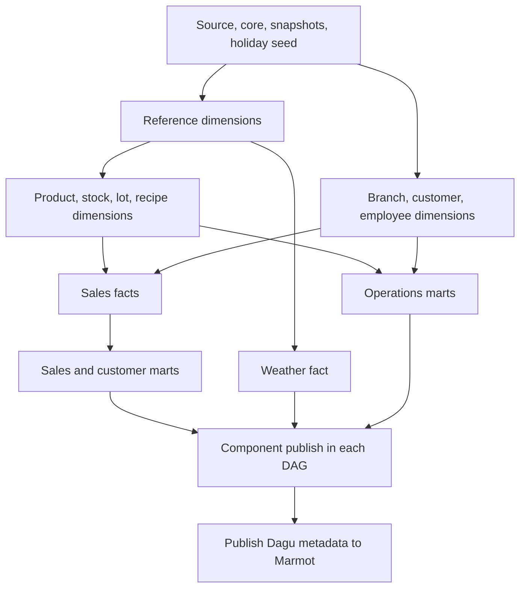

# Bakery Dagu workflows

The nightly ETL is scheduled as separate DAGs to spread work across time.
There is no parent DAG that reassembles the full pipeline; each component is
addressable on its own and shares the batch gate through `BATCH_ID=auto`.

## Schedule and ownership

All times use `Asia/Ho_Chi_Minh` from `config.yaml`.

| Time | DAG | Owned work |
|---|---|---|
| 22:00 | `weather-daily` | Collect completed daily Open-Meteo observations. |
| 22:15 | `source-core` | Preflight → staging/core/snapshots/seed → scoped tests → component publication. |
| 22:30 | `dimensions-reference` | dbt run → scoped tests → publish six reference dimensions. |
| 22:40 | `dimensions-parties` | dbt run → scoped tests → publish branch, customer and employee dimensions. |
| 22:50 | `dimensions-products` | dbt run → scoped tests → publish stock, lot, product and recipe dimensions. |
| 23:05 | `facts-sales` | dbt run → scoped tests → publish sales facts. |
| 23:15 | `facts-weather` | dbt run → scoped tests → publish weather fact. |
| 23:25 | `marts-sales` | dbt run → scoped tests → publish sales marts. |
| 23:35 | `marts-operations` | dbt run → scoped tests → publish operations marts. |

The 23 mart models each have exactly one owner in `analytics/selectors.yml`.
The three dimension DAGs retain all existing SCD2/sequence behavior; `dim_date`
remains Type 0. Fact and mart SQL/materializations are unchanged.

These are enqueue times, not guaranteed start times. The shared `bakery`
queue has `max_concurrency: 1`; a long job delays later jobs rather than
overlapping them. Each DAG has `max_active_steps: 1`. dbt's profile now reads
`DBT_THREADS`, default **1** instead of 4; Compose also defaults the Dagu
container to 1 and explicitly allows that variable through to task processes.
This limits concurrent model queries as well as concurrent DAGs. The 10–20
minute gaps are an initial operating schedule, not a measured RAM ceiling.
PostgreSQL/Cube/other services and an individual large query can still consume
memory; adjust the windows after observing actual run durations and peak RSS.

## Dependencies and shared batch



Cron does not establish dependencies. Every component defaults `BATCH_ID` to
`auto`, resolved to `daily-YYYY-MM-DD` for the local nightly window beginning
at 06:00 and ending before 06:00 the next day. An explicit batch ID supports recovery
of a delayed batch after 06:00.

`pipeline.py` checks successful prerequisite markers in that exact batch
before running dbt. Every dbt component DAG has explicit `run`, `test`,
`publish` and `metadata` tasks; the publish task writes a filtered
manifest/catalog/result bundle for that component and immediately ingests it
into Marmot. The final metadata task publishes the DAG/task/run graph to
Marmot. A
missing/failed prerequisite causes failure before a write; it does not reuse
yesterday's completion markers. A retry invalidates the retried job and its
actual descendants while preserving unrelated successful branches. If an
upstream job fails, later cron jobs can therefore fail their dependency check;
recover the affected jobs in dependency order.
The existing retry policy is two retries spaced 60 seconds apart, not an
indefinite dependency wait.

All attempts retain their own `execution.json` with the batch ID and real
Dagu run ID. dbt artifacts are retained per job/attempt under
`analytics/target/dagu/runs/<batch-id>/`; component publication bundles are
under each `<component>-publish` attempt. Marmot schedules are idempotent per
component, so a retry updates the same catalog assets. There is no nightly
cross-component validation or aggregate publication DAG.

The `metadata` task at the end of every DAG syncs Dagu's pipeline/task/run
graph to Marmot. It does not run mart business enrichment. Run
`enrich_bakery_mart_metadata.py` manually when mart descriptions or column
metadata need refreshing. The standalone `catalog.py dbt` command remains
available for an intentional full catalog refresh.
Weather collection remains a separate ingestion job; its existing collector
does not produce a dbt batch marker. Inspect its result/freshness separately.

Source generation remains manual. Finish and commit source writes before
the nightly window; do not mutate source while dependent jobs consume a batch.
If source or transformation code changes during recovery, run a new complete
batch rather than combining old and new intermediate results.

## Manual execution and recovery

The normal scheduler starts each component separately. To deliberately rerun
one component of an existing batch, enqueue that component with the same
`BATCH_ID` after its prerequisites succeed. For example, rerun sales facts:

```bash
curl --fail --silent --show-error -X POST \
  http://localhost:8088/api/v1/dags/facts-sales/enqueue \
  -H 'Content-Type: application/json' \
  -d '{"params":"{\"BATCH_ID\":\"daily-2026-10-22\"}"}'
```

Wait for success; the component's run, test, publish and metadata tasks run in
that single DAG. Then rerun `marts-sales` with the same `BATCH_ID`. Other branches can
retain their successful results provided their upstream inputs have not
changed. Rerunning the source/core job invalidates all downstream branches.
Use the actual batch date/run ID, not the example date. Keep retries/enqueue
in the shared queue; do not invoke standalone dbt alongside scheduled work.

For a manually coordinated batch, use one explicit batch ID consistently across
the component enqueue calls. Each DAG publishes its own metadata after its
publish task completes.

Marmot's adapter exports the actual child-pipeline dependencies and reads
child execution history through Dagu's root/sub-run REST endpoints. It
continues to exclude commands, parameter values, environment and logs.

## Verification

```bash
./.venv/bin/python analytics/run_pipeline.py --check
./.venv/bin/python -m unittest discover -s data_platform/dagu/test -v
./.venv/bin/python -m unittest discover -s analytics/test -v
docker compose config --quiet
```

Optionally run the cross-process smoke test using the pinned Dagu 2.21.0
binary: set `DAGU_TEST_BINARY=/absolute/path/to/dagu` when running the Dagu
test suite. It executes the real component entrypoints in temporary directories
with synthetic dbt artifacts. It does
not connect to the Bakery database, call Marmot or run real ETL. Live
acceptance and memory measurements require the platform to be running.
